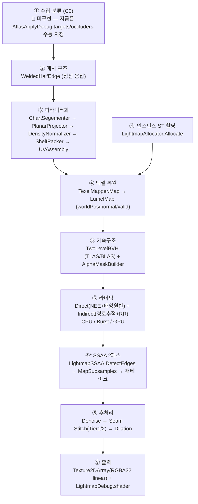

# CustomLightmapper — 개발 내용 정리

> 기준일 2026-10-14 · 패키지 v0.14.0 · 마지막 코드 커밋 `5a727ff`(SSAA, 2026-08-14)
> 수치는 모두 에디터 실측값(출처: `04_Complete_Dev_Docs/09_검증_테스트_매트릭스.md`, 진행상황 문서).

---

## 1. 프로젝트 개요

Unity 내장 Progressive Lightmapper를 **처음부터 다시 만든** 오프라인 라이트맵 베이커다.

- **목표**: 대량 프롭·인스턴싱 씬에서 Unity 베이커의 한계(속도, 인스턴스 처리, 알파 차폐 품질)를 넘는 자체 파이프라인.
- **2-트랙 구조**
  - **Track A — 라이트맵 텍셀 베이크**: 정적 메시에 UV2를 직접 만들고 아틀라스에 GI를 굽는다.
  - **Track B — 프로브 베이크**: 대량 인스턴스(프롭·식생)에 SH9 프로브를 굽는다. 현재 SH 인스턴싱 경로만 완료.
- **공유 엔진**: 두 트랙이 같은 BVH·경로추적 코어(`RadianceCore` / Burst / GPU)를 쓴다.
- **렌더 파이프라인**: URP에서 개발. BIRP 포팅은 보류(2026-07-09 결정).

### 패키지 구조

```
Packages/com.huskylibs.customlightmapper/
├── Runtime/    HuskyLibs.CustomLightmapper           ← 베이크 코어(배포 대상)
├── Editor/     HuskyLibs.CustomLightmapper.Editor    ← 에디터 메뉴/윈도우
├── Tests/      HuskyLibs.CustomLightmapper.Tests     ← static RunAll() 자체검증
├── Samples/    HuskyLibs.CustomLightmapper.Samples   ← MonoBehaviour 하니스 + 샘플 씬
├── Shaders/    셰이더 + Resources/*.compute (Resources.Load)
└── Documentation~/
```

의존 방향: `Runtime` ← `Tests` ← `Editor`, `Samples`. Runtime은 Burst/Collections/Mathematics만 참조한다.

---

## 2. 베이크 파이프라인



> 실제 오케스트레이션은 `Runtime/LightmapAllocator/AtlasApplyDebug.cs`(2026-10-26 병합으로 Samples → Runtime)의 `BakeAndApply()`가 한다.
> 아직 Runtime에 독립 "베이커 API"는 없고, 이 컴포넌트가 사실상의 베이커다.

---

## 3. 트랙별 개발 내용

### 3.1 A트랙 — UV 파라미터화 (A1~A4) ✅

| 단계 | 내용 | 핵심 클래스 |
|---|---|---|
| A1 | 메시 → Half-Edge(DCEL), 위치 기반 정점 용접 | `HalfEdge`, `WeldedHalfEdge` |
| A1 | 노멀 각도 기반 best-first 영역성장 차트 분할 | `ChartSegementer`, `SegmentationSettings` |
| A2 | 차트 평탄화 — Planar → LSCM(등각) → MVC(전단사) 디스패치 (v15.14) | `ChartFlattener`, `PlanarProjector`, `LSCMSolver`, `MVCFallback` |
| A2 | foldover(뒤집힌 삼각형) 검출 | `UVValidator` |
| A3 | 월드 면적 기준 밀도 정규화 + 셸프 패킹 | `DensityNormalizer`, `ShelfPacker` |
| A3 | uv2(채널1) 메시 조립 + 시임 테이블 | `UVAssembly`, `SeamTable` |
| A4 | 인스턴스별 월드 면적 → ST(ScaleOffset) + 페이지 | `LightmapAllocator` |
| A5 | uv2 래스터 → 텍셀별 월드 위치/노멀 | `TexelMapper` |

### 3.2 C1 — 가속구조 BVH ✅ 검증

- 단일 레벨 BVH: Median / SAH(12 bin) 두 빌드 품질.
- 2단 BVH(TLAS/BLAS): 유니크 메시 1개 = BLAS 1개, 인스턴스는 행렬만 → **같은 메시 다중 인스턴스가 BLAS 공유**.
- `IOccluder` 인터페이스로 BruteForce(정답)와 교체 가능 → 무작위 레이 수천 발로 `miss=0` 교차검증.

### 3.3 C2 — 라이팅 RadianceCore ✅ 검증

| 항 | 방식 |
|---|---|
| AO | 코사인 가중 반구 샘플링 |
| Direct | Directional Light NEE + 그림자 레이. **태양 원반 샘플링**(`directSamples`, `sunAngularDiameterDeg`)으로 소프트 섀도 |
| Indirect | 경로추적 + 러시안 룰렛, 하늘(`ISky`: Uniform/Gradient) 미스 레이 |
| 씬 | `InstancedRadianceScene` — 2단 BVH + per-mesh/per-instance 알베도 |

결정적 시드 규약 `seed + li * 2654435761u` 를 **모든 백엔드가 동일하게** 쓴다. 이것이 교차검증의 전제다.

### 3.4 G0~G3 — Burst 백엔드 ✅ 검증

- 관리형 BVH를 POD 배열로 평탄화한 `BurstScene` + static 순회 `BurstTwoLevelBVH`.
- `AoJob` / `DirectJob` / `IndirectJob` (`IJobParallelFor`), 합성은 `BurstRadianceBaker.Bake`.
- **실측**: 77만 텍셀 실 베이크에서 CPU 대비 mean ≈ 0.

### 3.5 G4~G6 — GPU Compute ✅ 검증

| 단계 | 내용 | 실측 |
|---|---|---|
| G4 | `BvhTraverse.compute` 2단 순회 (`CSClosestHit`/`CSOccluded`) | 5000 레이 miss 0, maxErr 1.1e-5 |
| G5 | `PathTrace.compute` (`CSAO`/`CSDirect`/`CSIndirect`) | Burst와 사실상 비트 동일 (Direct 8e-10) |
| G6-1 | 레지스터 압박 X4714 해소 (스택 64→32) | 회귀 비트 동일 |
| G6-2 | `CSRadiance` 1-디스패치 + 텍셀별 `_Seeds` 버퍼 → `AtlasApplyDebug` 배선 | 653,780 텍셀 meanDiff 3e-7 · **6.1×** |
| G6-3 | 영구 버퍼(`GpuIoBuffers`) + AsyncGPUReadback | **Burst 3134ms → GPU 440ms = 7.2×** |

### 3.6 후처리 ✅

처리 순서는 **Denoise → Seam Stitch → Dilation** 으로 고정이다(경계값을 안정화한 뒤 맞추고, 그 값을 거터로 확장).

| 단계 | 내용 |
|---|---|
| Denoise | À-trous joint bilateral. 월드 노멀·위치·색(RGB L2) 가이드로 하드 엣지·차트 경계·그림자 경계 보존. Serial ≡ Burst |
| Seam Stitch Tier1 | 같은 원본 정점에서 갈라진 경계 텍셀 그룹 평균 |
| Seam Stitch Tier2 | 경계 모서리를 공유 t로 DDA 순회하며 양쪽 텍셀 평균 |
| 노멀 게이팅 | `seamMaxAngleDeg` 이하 시임만 스티칭 → 하드 엣지 밝은 테두리(rim) 방지 |
| Dilation | Push-Pull로 거터/배경 텍셀 확장. Serial ≡ Burst |

### 3.7 α 트랙 — 알파 컷아웃 any-hit 그림자 ✅ 검증

- **문제**: 나무 잎 쿼드가 통짜 판으로 그림자를 만듦.
- **해결**: 머티리얼 알파를 사전 이진화한 **비트마스크**로 굽고, 레이가 투명 텍셀에 맞으면 순회를 계속(any-hit). 정수 비트 연산이라 3백엔드 구조적 비트 동일.
- `Tri` 구조(36B)는 그대로 두고 UV·서브메시를 병렬 배열로 추가 → 컷아웃이 없으면 기존 코드 경로가 그대로 실행(드리프트 0).
- 머티리얼 판별: `_AlphaClip`/`_Cutoff`/렌더큐 + **SpeedTree는 셰이더 이름으로만** 판별 가능. 강제 지정 탈출구(`alphaForceCutout`, `alphaForceCutoutNames`).
- **실측**: 실 나무 씬에서 원래 그림자였던 레이의 20.6%가 잎 사이로 통과. 비용은 bake 10.1s → 17.6s(1.74×, early-exit 포기가 원인).
- ⚠ 구 `Radiance` 모드에는 미적용 — **`RadianceGI` 모드에서만** 동작.

### 3.8 SSAA — 텍셀 내부 슈퍼샘플링 ✅

- **문제**: 그림자 경계가 텍셀 단위 계단으로 보임(반그림자 폭 < 텍셀 크기면 태양 원반 샘플링으로도 해결 불가).
- **해결**: 1패스 결과에서 상대 휘도차로 엣지 텍셀을 찾고(`LightmapSSAA.DetectEdges`), 그 텍셀만 S×S 서브샘플로 재베이크(`TexelMapper.MapSubsamples`).
- `Off` / `Adaptive`(권장, 총 레이 ≈1.1~1.3×) / `Full`(레퍼런스, S²배). `Off`는 기존과 비트 동일.
- 이 작업으로 `BakeGiLumelsBurst/Gpu`가 `BakeLumels` + `BakePoints`(임의 점 리스트)로 일반화됨 → Track B가 그대로 재사용할 진입점.

### 3.9 SH 트랙 — 인스턴싱 프로브 ✅ 검증 (URP)

| 단계 | 내용 |
|---|---|
| 어댑터 | `TemplateInstanceSource` — Mesh 템플릿 + 행렬 배열 → 씬. 프로브 앵커 5모드(`AnchorMode`) |
| SH-1 | `SH9` — 9계수 프로젝션/조도, Unity `ShadeSH9`와 일치 |
| SH-2 | `BurstSHBaker` — Fibonacci 구 방향, 1바운스 + 하늘 앰비언트 |
| SH-3 | `SHPacked`(7×float4 = 112B) + `SHInstancedBuffer`(GraphicsBuffer) |
| SH-4 | `SHDebugView` 기즈모 |
| SH-5 | `InstancedSH_URP.shader` + `InstancedSHRenderer`(`DrawMeshInstancedIndirect`). 인스턴스당 **상·하 2-프로브** 수직 보간, 임의 3축 회전 지원 |
| SH-G | `PathTrace.compute` `CSSHBake` — GPU SH 베이크. Burst 대비 mean 1e-8 |

---

## 4. 검증 체계

- **3백엔드 교차검증**: CPU(ground truth) ≡ Burst ≡ GPU. 같은 시드·같은 평가 원점(`worldPos + normal*surfaceBias`).
- **한 버튼 회귀**: `LightmapEvaluateDebugger` → `Run All Tests (C1+C2)` — 16개 테스트 클래스, **109/109 PASS**.
- **비트 동일 게이트**: 새 기능(α, 태양원반, SSAA)은 기본값에서 기존 수치와 자릿수까지 같아야 통과.

| 대표 수치 | 값 |
|---|---|
| G4 GPU BVH vs Burst | maxErr 1.1e-5, miss 0 |
| G5 GPU 경로추적 vs Burst | Direct 8.3e-10 · AO 0 · Indirect 2.5e-9 |
| G6 실 아틀라스 Burst vs GPU | 653,780 텍셀 meanDiff 3e-7, over(1/255) 0.001% |
| SH-G GPU vs Burst | mean 9.7e-9 |
| 속도 | GPU 440ms vs Burst 3134ms (7.2×) |

---

## 5. 알려진 한계 · 주의

| 항목 | 내용 |
|---|---|
| 평탄화 | (v15.14 해소) LSCM/MVC 구현 — 비원판 차트(원통 고리 등)는 MVC 보장 밖이라 분할에 의존 |
| 광원 | Directional + Sky만. Point/Spot/Area 없음 |
| 출력 포맷 | 아틀라스가 **RGBA32 linear**(LDR 클램프). RGBAHalf HDR 출력은 문서상 계획이나 미구현 → 1.0 넘는 직사광이 잘림 |
| 진입점 | 실 씬 자동 수집 없음(C0). 대상은 인스펙터에 수동 지정 |
| 메시 | 임포트 메시는 **Read/Write Enabled** 필요 |
| 알파 | `RadianceGI` 모드 전용 |
| SH | 1바운스 + 앰비언트. 다중 바운스 미구현 |
| GPU 스택 | `BVH_STACK=32`(CPU/Burst 64) — 거대·불균형 메시에서 재검토 필요 |
| asmdef | Tests/Samples의 `includePlatforms`가 비어 있음 → 소비자 빌드에 포함됨(CHANGELOG 의도와 다름) |
| 잔재 | `SceneRadianceBuilder.cs` 빈 파일 |

---

## 6. 남은 작업 (우선순위)

| 순위 | 항목 | 비고 |
|---|---|---|
| 1 | **C0 씬 수집·분류** | 설계·개발문서 완료. C0-0 정책 코어(헤드리스 테스트 T1~T8)부터. 게이트 V3(수동 배열과 아틀라스 비트 동일)·V6(α 정합 무손상)이 핵심 |
| 2 | B1 범용 프로브 격자 / 정점 베이크 | `BakePoints` 재사용, 샘플 지점 공급만 교체 |
| 3 | ~~LSCM / MVC 솔버 본체~~ | ✅ v15.14 |
| 4 | Point / Spot / Area 광원 | `ILight.Sample` 계약 확정 후 3백엔드 미러 |
| 5 | SH-2 다중 바운스 · `iid*7` 인덱싱 자동검증 | |
| 6 | G6-3b 단일 글로벌 디스패치 · 타일/적응 샘플링 | |
| 정리 | RGBAHalf 출력, Tests/Samples asmdef Editor 한정, 빈 파일 제거, 미작성 시임 테스트 | |
| 제외/보류 | 지형 QuadTree(제외, 2026-08-18) · BIRP 포팅(보류) | |

### C0 구현 시 반드시 지킬 것

1. 정제(클린업)한 메시를 **차폐 씬에 넣지 말 것** — α의 TriUV가 `mesh.triangles`와 1:1이라 삼각형 수가 바뀌면 그 메시 알파가 조용히 꺼진다.
2. 수집 순서를 **정렬하지 말 것** — 인스턴스 인덱스가 ST 할당과 텍셀 시드에 들어간다.
3. 수집 단계에서 `LightmapAllocator.WorldArea` 호출 금지 — 면적 0 판정은 `renderer.bounds`로.
4. 베이크 경로 코드는 무변경 — `AtlasApplyDebug`에는 `SetCollected` 세터 하나만 추가.
5. Samples asmdef는 Editor를 참조하지 않는다 — 메뉴는 `Editor/SceneCollectMenu.cs`에.
